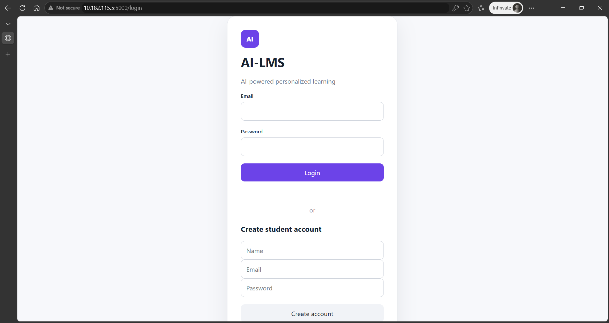
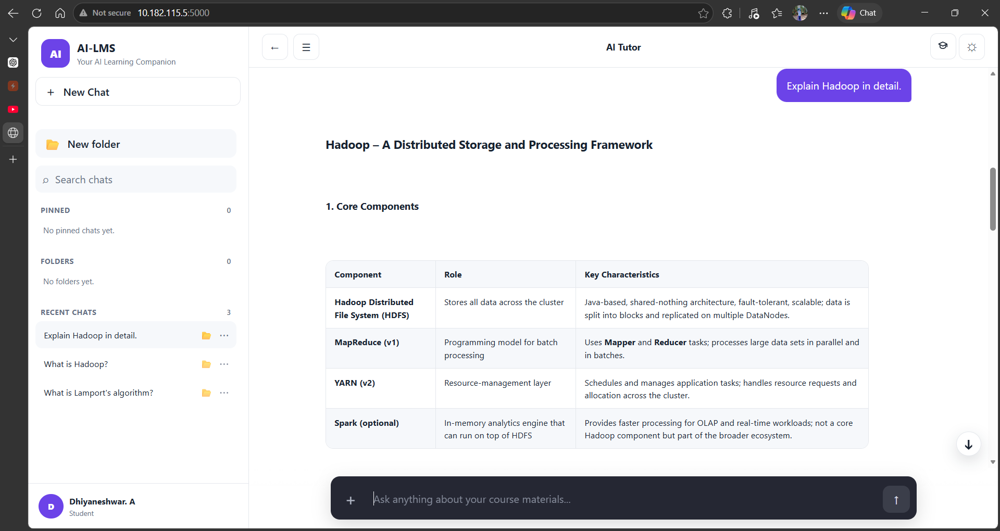

# LeeLearn – AI-Powered Learning Management System

**An intelligent Learning Management System powered by Artificial Intelligence and Retrieval-Augmented Generation (RAG).**

LeeLearn is designed to improve the teaching and learning experience through AI-powered tutoring, automated quiz generation, assignment creation, and intelligent learning assistance.

## 🚀 Features

- **AI Tutor:** Interactive chatbot for answering student questions.
- **RAG-Based Question Answering:** Retrieves relevant information from course materials.
- **Automatic Quiz Generation:** Generates questions from educational content.
- **Assignment Generator:** Creates short-answer and long-answer questions.
- **Course Management:** Supports teacher and student learning activities.
- **Learning Materials:** Upload, organize and access educational documents.
- **Chat History:** Maintains student conversations.
- **YouTube Recommendations:** Recommends educational resources.

## 📸 Application UI Previews

*Illustrative interface designs of LeeLearn.*

### AI Tutor Interface



### RAG-Based AI Tutor



## 🧠 RAG Architecture

LeeLearn uses Retrieval-Augmented Generation to provide answers grounded in educational materials.

1. PDF text extraction and OCR.
2. Document preprocessing and chunking.
3. Semantic embedding generation.
4. Vector indexing.
5. Similarity-based document retrieval.
6. Context-based answer generation using a local LLM.

## 🛠️ Technology Stack

| Component | Technology |
|---|---|
| Programming Language | Python |
| Backend | Flask |
| Frontend | HTML, CSS, JavaScript |
| Database | SQLite |
| LLM Runtime | Ollama |
| Language Models | Gemma 3 4B, Qwen 3 4B |
| Embedding Model | Sentence Transformers |
| Vector Search | FAISS |
| PDF Processing | PyMuPDF |
| OCR | Tesseract |

## ⚙️ Installation

### 1. Clone the repository

```bash
git clone https://github.com/dhiyaneshwar609/AI-LMS.git
cd AI-LMS
```

### 2. Create a virtual environment

```bash
python -m venv .venv
```

### 3. Activate the environment

```powershell
.venv\Scripts\Activate.ps1
```

### 4. Install dependencies

```bash
pip install -r requirements.txt
```

### 5. Install Ollama

Download Ollama from https://ollama.com/

Pull a supported model:

```bash
ollama pull gemma3:4b
```

Alternatively:

```bash
ollama pull qwen3:4b
```

### 6. Configure environment variables

Create a `.env` file in the project root:

```env
AI_LMS_SECRET_KEY=your_secure_random_secret
```

Generate your own secure random secret. Never publish your `.env` file.

### 7. Run the application

```bash
python app.py
```

## 🎯 Project Objective

To integrate Artificial Intelligence into traditional Learning Management Systems by providing intelligent tutoring, automated assessments, and personalized learning assistance.

## 👨‍💻 Repository

GitHub: https://github.com/dhiyaneshwar609/AI-LMS

## 📜 License

A suitable open-source license and redistribution permissions for included educational materials should be established before reuse.